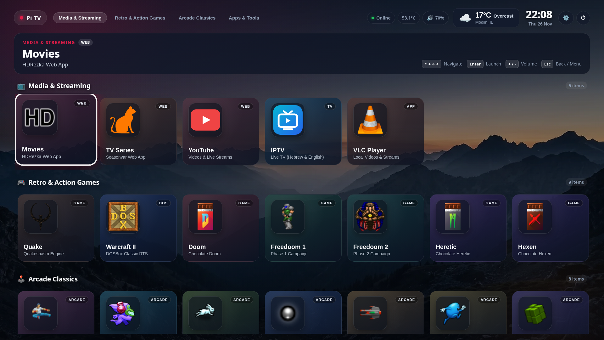

# Pi TV — Custom Raspberry Pi Browser Kiosk UI

A lightweight, 10-foot Smart TV dashboard for Raspberry Pi OS (`labwc` / Wayland) powered by a zero-dependency Python 3 backend and Chromium Kiosk Mode.



## Features
- **Live Local Clock & Weather** (powered by free Open-Meteo API, auto-location or custom city, °C/°F toggle, 4-day forecast modal).
- **Organized Sections** pre-populated with your installed Raspberry Pi apps & games:
  - **Media & Streaming**: Movies (HDRezka), TV Series (Seasonvar), YouTube, VLC Player
  - **Retro & Action Games**: Quake, Warcraft II (DOSBox), Doom, Freedoom 1 & 2, Heretic, Hexen
  - **Arcade Classics**: Beat Streets, Cavern, Bunner, Boing, Avenger, Eggzy, Kinetix, Leading Edge
  - **Apps & Tools**: Chromium, Firefox, Google Gemini, RPi Connect, Pi-Apps, System Monitor, Terminal
- **TV Remote & Keyboard First**: Full spatial navigation (`▲▼◀▶`, `Enter`, `Esc`, `PageUp/Down`, `+/-/M` volume), plus Mouse and USB/Bluetooth Gamepad support.
- **Dedicated Kiosk Profile**: Uses its own Chromium profile (`~/.local/share/pi-tv-kiosk-profile`) so launching normal Chromium or web apps works cleanly without breaking kiosk mode.
- **System Controls**: Live Pi CPU temperature, network indicator, PipeWire volume control, Exit-to-Desktop, Reboot, and Shutdown.

## Quick Start (Manual Testing)

Test in a resizable window first:
```bash
~/pi-tv-ui/scripts/start-tv.sh --windowed
```

Launch full-screen Chromium Kiosk Mode:
```bash
~/pi-tv-ui/scripts/start-tv.sh
```

> Press `Alt+F4` or select **⏻ → Exit to Desktop** to leave kiosk mode at any time.

## Enable / Disable Auto-Launch on Boot

Check status:
```bash
~/pi-tv-ui/scripts/toggle-kiosk-autostart.sh status
```

Enable auto-launch on Raspberry Pi OS login:
```bash
~/pi-tv-ui/scripts/toggle-kiosk-autostart.sh enable
```

Disable auto-launch:
```bash
~/pi-tv-ui/scripts/toggle-kiosk-autostart.sh disable
```

## Customizing Apps, Games & Sections

Edit `~/pi-tv-ui/config.json`, then press **⚙️ → Reload config.json** (or **⏻ → Reload TV UI**).
Each item accepts:
- `id`: unique identifier
- `name` & `subtitle`: card title and caption
- `icon`: either an XDG icon name (e.g. `vlc`, `firefox`) or an absolute image path (e.g. `/home/andrey/Pictures/my-icon.png`)
- `accent`: hex color used for the card tint and dynamic background glow
- `badge`: short tag (`WEB`, `GAME`, `APP`, `DOS`, etc.)
- `command`: array of executable + arguments (e.g. `["vlc"]`)
- `cwd` *(optional)*: working directory for the command
